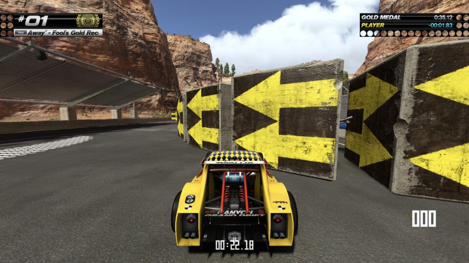
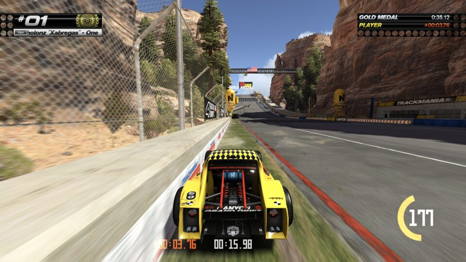
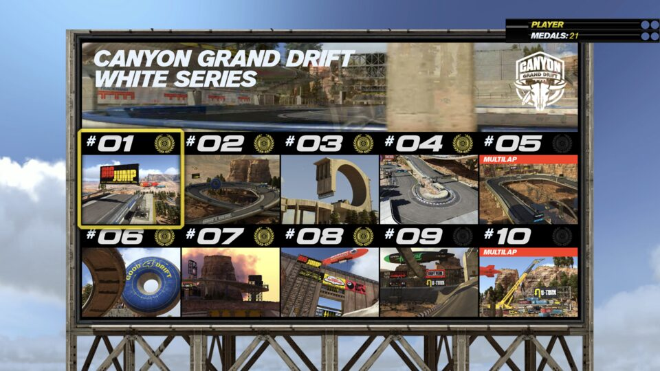
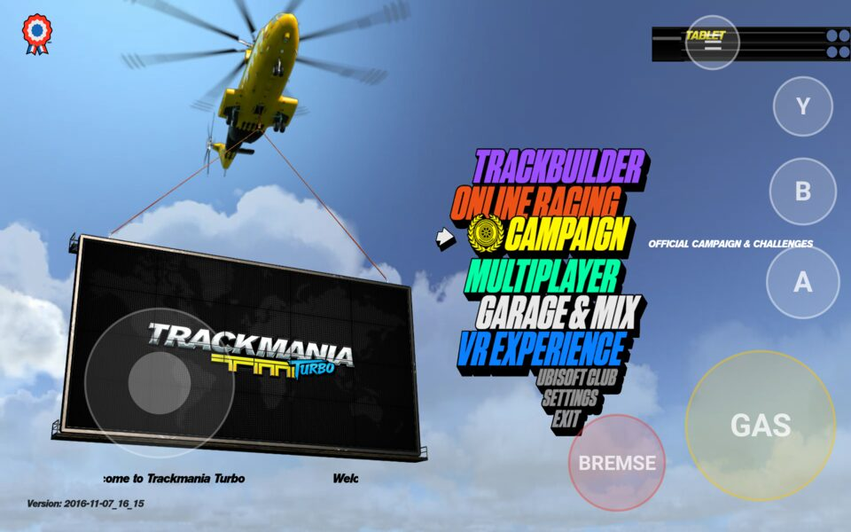
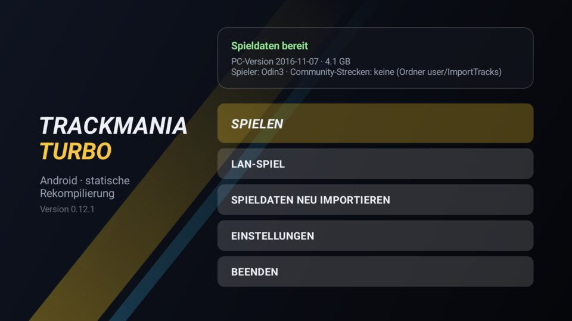
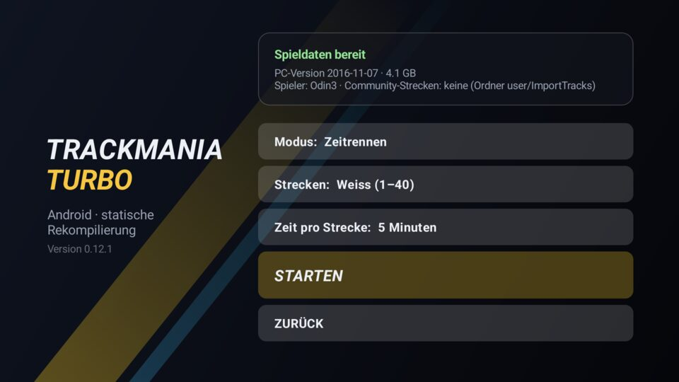

# Trackmania Turbo – Android-Port (zum Selberbauen)

Die PC-Version von **Trackmania Turbo** als native Android-App (arm64), offline spielbar.
Der Port ist eine **statische Rekompilierung**: der x86-Code der `TrackmaniaTurbo.exe` wird in
C übersetzt und für ARM64 kompiliert; eine eigene Windows-Laufzeit ersetzt
kernel32/user32/Winsock/XInput, Direct3D 11 läuft über DXVK auf Vulkan, der Ton über OpenAL Soft.

**Hier gibt es keine fertige APK und nichts vom Spiel.** Du baust die APK selbst aus **deiner
eigenen** PC-Installation: Der Build übersetzt deine EXE auf deinem Rechner; das Repository
enthält nur Werkzeuge, Laufzeit und eine Adressliste der Funktionen (keinen Code des Spiels).
Die Spieldaten (Strecken, Grafik, Ton …) importiert die App später auf dem Gerät ebenfalls aus
deiner Installation. Die gebaute APK enthält rekompilierten Code deiner EXE – sie ist für dich,
nicht zum Weitergeben.

*English version: [README.md](README.md)*

## Bilder

<table>
  <tr>
    <td width="50%"><br><sub>Kampagnen-Strecke #01 auf der AYN Odin3, 60 fps</sub></td>
    <td width="50%"><br><sub>Canyon-Strecke</sub></td>
  </tr>
  <tr>
    <td width="50%"><br><sub>Streckenauswahl der Kampagne</sub></td>
    <td width="50%"><br><sub>Hauptmenü mit Touch-Gamepad (iPlay60 mini Turbo)</sub></td>
  </tr>
  <tr>
    <td width="50%"><br><sub>Startbildschirm der App</sub></td>
    <td width="50%"><br><sub>LAN-Spiel eröffnen</sub></td>
  </tr>
</table>

## Was du brauchst

- Deine PC-Version von Trackmania Turbo, genau dieser Build:
  `TrackmaniaTurbo.exe` vom 2016-11-07 (16:15),
  SHA-256 `454b0d4d9eb778a298e523c20f9bb0b9e5459217afd45566dfcffe9bb8312879`
  (der Build prüft das, ebenso die beiden mitgelieferten DLLs `audiomotors_shared_mt.dll` und
  `libwebp.dll`).
- Zum Bauen: einen PC mit **Docker** (Linux, macOS, oder Windows mit WSL2; auf Macs mit
  Apple-Chip emuliert Docker x86-64, das dauert deutlich länger),
  **≥ 16 GB RAM**, **~30 GB freien Platz** und Internet (der Build lädt Android-SDK/NDK und
  die Fremdbibliotheken). Dauer: grob 30 Minuten auf 16 Kernen, auf 4 Kernen eher 2–3 Stunden.
- Zum Spielen: ein Android-Gerät mit 64-Bit-ARM, Vulkan, Android 10+, ~4,5 GB frei.
  Getestet: **AYN Odin3** (Snapdragon 8 Elite) und **iPlay60 mini Turbo** (Snapdragon 6 Gen 1).
  Geräte mit Mali-Grafik sind ungetestet.

## Bauen

```sh
git clone https://github.com/zwaetschge/trackmania-turbo-android.git
cd trackmania-turbo-android
./build.sh "/pfad/zu/Trackmania Turbo"        # der Spielordner (mit TrackmaniaTurbo.exe)
#  oder: ./build.sh "/pfad/zu/TrackmaniaTurbo.zip"
```

Ergebnis: `out/TrackmaniaTurbo-Android-<version>.apk`.

Was `build.sh` macht (in Docker, Details in `tools/build_all.sh`):

1. EXE und die zwei DLLs aus deinem Spielordner/ZIP nach `ref/` kopieren und per SHA-256 prüfen
2. Fremdquellen in festen Versionen holen (`tools/fetch_deps.sh`): DXVK, OpenAL Soft, libvpx,
   der Lifter pcrecomp samt den Änderungen dieses Ports (`tools/patches/pcrecomp`)
3. die Funktionsliste (`port/catalog/*.json.xz`, nur Adressen) entpacken
4. **Liften:** x86 → C, 2,5 GB Quelltext in `gen/` (bleibt lokal)
5. DXVK für Android vorbereiten
6. `libtmturbo.so` mit dem Android-NDK kompilieren (der lange Teil)
7. die APK mit Gradle bauen und signieren (der Schlüssel bleibt in `work/` und wird bei
   späteren Builds wiederverwendet, damit Updates über die alte Version installierbar sind)

Weniger Speicher? `JOBS=4 ./build.sh …` begrenzt die parallelen Compiler. Docker Desktop
(macOS/Windows) gibt seiner VM anfangs wenig RAM – in den Einstellungen auf ≥ 16 GB stellen.
Gemessen: 25 Minuten auf 16 Kernen (Liften 3 Min., Kompilieren 21 Min.), APK ~130 MB.
Linux ohne Docker: dieselben Werkzeuge wie in `build/Dockerfile`, dann `tools/build_all.sh`.

## Installieren und Spielen

1. Die APK aufs Gerät kopieren und installieren (Installation aus unbekannten Quellen erlauben).
2. App starten → **Spieldaten importieren** → den Spielordner wählen **oder** eine ZIP-Datei
   davon. Die App kopiert, was das Spiel braucht (~3,8 GB), prüft die EXE und richtet alles
   selbst ein (ZIP: ~2½ Minuten auf dem iPlay60 mini Turbo).
3. **Spielen** – beim ersten Start fragt die App nach deinem **Spielernamen** (im Rennen und
   bei LAN-Spielen sichtbar, später unter Einstellungen änderbar).

Ein neuer Build lässt sich über die alte Version installieren; Spieldaten und Profil bleiben.
Das gilt für Builds mit demselben Schlüssel (derselbe `work/`-Ordner). Ist eine anders signierte
Version installiert, muss sie zuerst deinstalliert werden – das löscht Spieldaten und Spielstand,
danach die Spieldaten neu importieren.

## Was geht

- Kampagne, alle Menüs, Musik und Sound, Replays/Ghosts, Spielstand bleibt gespeichert.
- Den Startbildschirm der App gibt es auf **Deutsch, Englisch, Französisch, Spanisch und
  Italienisch**: er folgt der Systemsprache, oder Einstellungen → Sprache. Das Spiel selbst läuft
  auf Englisch.
- **Steuerung:** eingebauter oder Bluetooth-Controller, bis zu 4 gleichzeitig, Vibration.
  **Touch-Gamepad** (Stick, Gas, Bremse, A/B/Y/☰) automatisch ohne Controller;
  Einstellung „Touch-Steuerung“: automatisch / immer / aus.
- **Maus/Touch in den Menüs:** Antippen = Klick; oben an den Rand tippen öffnet die
  ManiaPlanet-Leiste mit den Grafik-, Ton- und Steuerungs-Einstellungen des Spiels.
- **LAN-Spiel** über WLAN, alles im Startbildschirm: ein Gerät **LAN-Spiel → Spiel eröffnen**
  (Modus, Strecken, Zeit pro Strecke → Starten), die anderen **LAN-Spiel → Spiel beitreten** –
  offene Spiele erscheinen dort von selbst. Jedes Gerät braucht eigene Spieldaten.
  Getestet mit Odin3 + iPlay60 mini Turbo im selben Match über einen Streckenwechsel hinweg.
- **Community-Strecken:** `.Map.Gbx`-Dateien im Ordner `user/ImportTracks` der App erscheinen
  unter „My Tracks“.
- **60 fps** stabil (Standard). 120 fps ist wählbar; Android drosselt das Display aber auf
  60 Hz, sobald das Gerät warm wird.

## Was nicht geht

- Online-Spiel, Ranglisten und Achievements (Ubisoft-Server).
- Splitscreen mit mehreren Controllern ist eingebaut, aber noch nicht ausprobiert.

## Für Entwickler

- `runtime/` Windows-Laufzeit (Speicher, Threads, Dateien, Netzwerk, LAN, Eingabe, …),
  `gfx/` Direct3D-11-Brücke und DXVK-Anpassungen (`gfx/dxvk/prepare.py`), `audio/` OpenAL,
  `android/` App (Startbildschirm, Import, Eingabe, LAN), `host/` dieselbe Laufzeit als
  Linux-x86-64-Programm zum Debuggen, `config/` Lifter-Einstellungen, `tools/` Werkzeuge.
- Ändert sich die Funktionsliste: `tools/catalog_pack.py pack work/catalog.json port/catalog/…`.
- Die Entwickler-Skripte (`tools/device*.sh`, `hostgo.sh`, `dock.sh` …) lesen ihre Einstellungen
  (Gerät, Spielordner, Docker-Pfad) aus `tools/env.sh` bzw. `work/local.env`; für `./build.sh`
  braucht es das nicht.
- Der Weg dorthin und alle Befunde (englisch): [`port/RECOMP_STATUS.md`](port/RECOMP_STATUS.md).

## Rechtliches

Dieses Repository enthält keine Dateien und keinen Code von Trackmania Turbo, nur eigenen Code,
Adresslisten und Werkzeuge. Den Build machst du mit deiner eigenen, rechtmäßig erworbenen
Kopie; die erzeugte APK ist nur für dich. Trackmania Turbo ist eine Marke von Ubisoft/Nadeo;
dieses Projekt steht in keiner Verbindung zu ihnen.

Der Code dieses Projekts steht unter der **MIT-Lizenz** ([LICENSE](LICENSE)). Fremdsoftware, die
der Build in festen Versionen holt: DXVK (zlib), OpenAL Soft (LGPL-2.1), libvpx (BSD-3),
Vulkan-Header aus nfsu2-recompiled (MIT), Lifter pcrecomp (MIT; die Änderungen in
`tools/patches/pcrecomp` ebenfalls MIT). Gradle-Wrapper: Apache-2.0.
