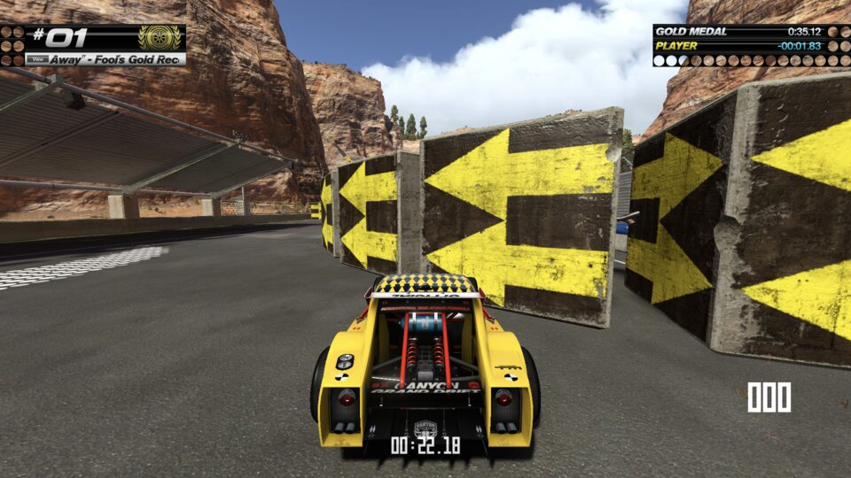
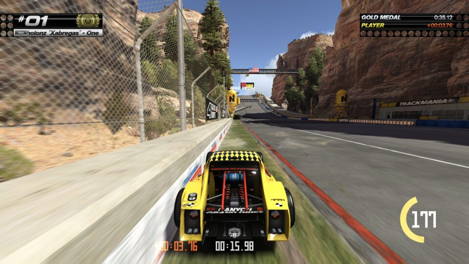
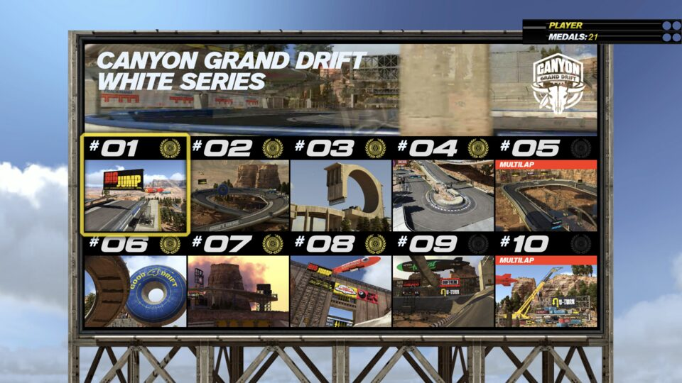
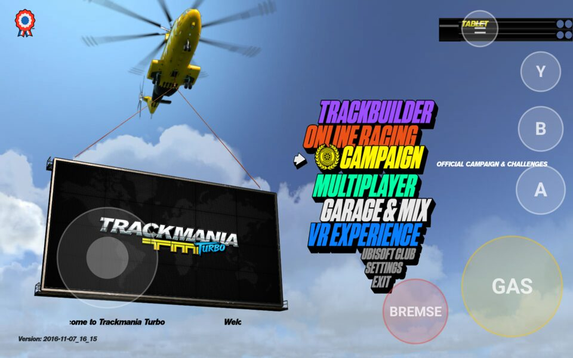
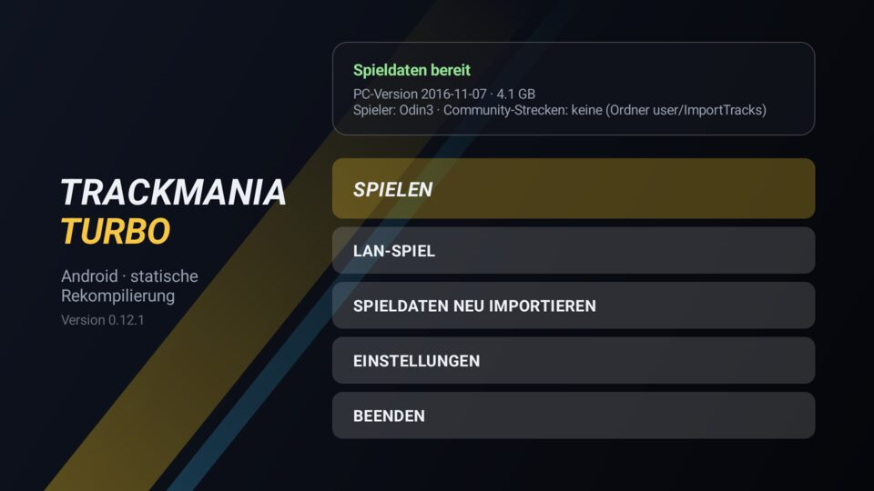
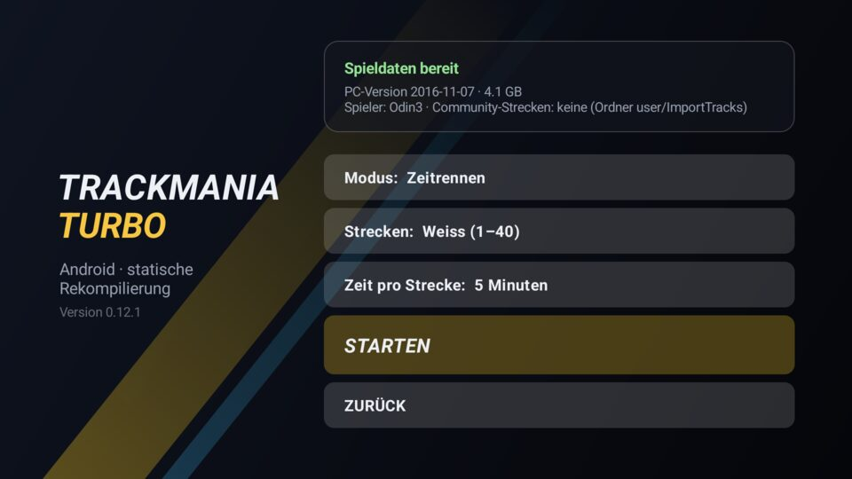

# Trackmania Turbo – Android port (build it yourself)

<p align="center"></p>

The PC version of **Trackmania Turbo** as a native Android app (arm64), playable offline.
The port is a **static recompilation**: the x86 code of `TrackmaniaTurbo.exe` is translated to
C and compiled for ARM64. A Windows runtime written for this project replaces
kernel32/user32/Winsock/XInput, Direct3D 11 runs on Vulkan through DXVK, and audio goes through
OpenAL Soft.

**There is no prebuilt APK here and nothing from the game.** You build the APK yourself from
**your own** PC installation: the build translates your EXE on your machine. This repository
only holds tools, the runtime and a list of function addresses (no game code). The app later
imports the game data (tracks, graphics, sound …) from your installation on the device. The
APK you build contains code recompiled from your EXE, so it is for you, not for sharing.

*Deutsche Version: [README.de.md](README.de.md)*

## Screenshots

<table>
  <tr>
    <td width="50%"><br><sub>Campaign track #01 on the AYN Odin3, 60 fps</sub></td>
    <td width="50%"><br><sub>Canyon track</sub></td>
  </tr>
  <tr>
    <td width="50%"><br><sub>Campaign track selection</sub></td>
    <td width="50%"><br><sub>Main menu with the touch gamepad (iPlay60 mini Turbo)</sub></td>
  </tr>
  <tr>
    <td width="50%"><br><sub>Start screen of the app</sub></td>
    <td width="50%"><br><sub>Hosting a LAN game</sub></td>
  </tr>
</table>

## What you need

- Your PC copy of Trackmania Turbo, exactly this build:
  `TrackmaniaTurbo.exe` from 2016-11-07 (16:15),
  SHA-256 `454b0d4d9eb778a298e523c20f9bb0b9e5459217afd45566dfcffe9bb8312879`.
  The build checks this, and also checks the two DLLs shipped with the game,
  `audiomotors_shared_mt.dll` and `libwebp.dll`.
- To build: a machine with **Docker** (Linux, macOS, or Windows with WSL2; on Apple-silicon
  Macs Docker emulates x86-64, which is a lot slower), **≥ 16 GB RAM**, **~30 GB free disk** and
  internet access (the build downloads the Android SDK/NDK and the third-party libraries).
- To play: an Android device with 64-bit ARM, Vulkan, Android 10+, ~4.5 GB free.
  Tested: **AYN Odin3** (Snapdragon 8 Elite) and **iPlay60 mini Turbo** (Snapdragon 6 Gen 1).
  Devices with Mali GPUs are untested.

## Build

```sh
git clone https://github.com/zwaetschge/trackmania-turbo-android.git
cd trackmania-turbo-android
./build.sh "/path/to/Trackmania Turbo"        # the game folder (with TrackmaniaTurbo.exe)
#  or: ./build.sh "/path/to/TrackmaniaTurbo.zip"
```

Result: `out/TrackmaniaTurbo-Android-<version>.apk`.

What `build.sh` does (in Docker; details in `tools/build_all.sh`):

1. copies the EXE and the two DLLs from your game folder/ZIP to `ref/` and checks their SHA-256
2. fetches the third-party sources at pinned versions (`tools/fetch_deps.sh`): DXVK,
   OpenAL Soft, libvpx, and the lifter pcrecomp with this port's changes
   (`tools/patches/pcrecomp`)
3. unpacks the function list (`port/catalog/*.json.xz`, addresses only)
4. **lifts** x86 → C: 2.5 GB of source in `gen/` (stays on your machine)
5. prepares DXVK for Android
6. compiles `libtmturbo.so` with the Android NDK (the long part)
7. builds and signs the APK with Gradle (the key stays in `work/` and is reused by later builds,
   so updates install over the previous version)

Less memory? `JOBS=4 ./build.sh …` limits the parallel compilers. Docker Desktop (macOS/Windows)
gives its VM little RAM by default; raise it to ≥ 16 GB in the settings.
Measured: 25 minutes on 16 cores (lifting 3 min, compiling 21 min), APK ~130 MB.
Linux without Docker: install the tools listed in `build/Dockerfile`, then run
`tools/build_all.sh`.

## Install and play

The app's screens are in German for now; the button names below are given as they appear.

1. Copy the APK to the device and install it (allow installs from unknown sources).
2. Start the app → **Spieldaten importieren** (import game data) → pick the game folder **or**
   a ZIP of it. The app copies what the game needs (~3.8 GB), checks the EXE and sets
   everything up (ZIP: ~2½ minutes on the iPlay60 mini Turbo).
3. **Spielen** (play). On the first start the app asks for your **player name** (shown in races
   and LAN games; change it later under **Einstellungen**, the settings).

A new build installs over the old one; game data and profile stay. This works for builds signed
with the same key (the same `work/` folder). If a differently signed version is installed,
uninstall it first. That deletes the game data and your progress, so import the game data again
afterwards.

## What works

- Campaign, all menus, music and sound, replays/ghosts; progress is saved.
- **Controls:** built-in or Bluetooth controller, up to 4 at once, rumble.
  A **touch gamepad** (stick, gas, brake, A/B/Y/☰) appears automatically when no controller is
  connected; setting "Touch-Steuerung": automatic / always / off.
- **Mouse/touch in the menus:** tap = click; tapping the top edge opens the ManiaPlanet bar with
  the game's graphics, sound and control settings.
- **LAN play** over Wi-Fi, all from the start screen: one device **LAN-Spiel → Spiel eröffnen**
  (host: mode, tracks, time per track → start), the others **LAN-Spiel → Spiel beitreten**
  (join); open games show up there by themselves. Every device needs its own game data.
  Tested with Odin3 + iPlay60 mini Turbo in the same match across a track change.
- **Community tracks:** `.Map.Gbx` files in the app's `user/ImportTracks` folder show up under
  "My Tracks".
- **60 fps**, stable (default). 120 fps can be selected, but Android drops the display to 60 Hz
  once the device gets warm.
- No Ubisoft Connect needed: the runtime answers the game's Uplay calls like Uplay's own offline
  mode.

## What doesn't work

- Online play, leaderboards and achievements (Ubisoft servers).
- Split screen with several controllers is implemented but not tried yet.

## For developers

- `runtime/` Windows runtime (memory, threads, files, network, LAN, input, …),
  `gfx/` Direct3D 11 bridge and DXVK changes (`gfx/dxvk/prepare.py`), `audio/` OpenAL,
  `android/` the app (start screen, import, input, LAN), `host/` the same runtime as a
  Linux x86-64 program for debugging, `config/` lifter settings, `tools/` tools.
- If the function list changes: `tools/catalog_pack.py pack work/catalog.json port/catalog/…`.
- The developer scripts (`tools/device*.sh`, `hostgo.sh`, `dock.sh` …) read their settings
  (device, game folder, Docker path) from `tools/env.sh` / `work/local.env`. `./build.sh` does
  not need any of that.
- How the port got here, with all findings: [`port/RECOMP_STATUS.md`](port/RECOMP_STATUS.md).

## Legal

This repository contains no files and no code from Trackmania Turbo, only original code,
address lists and tools. You build with your own, lawfully acquired copy; the APK you get is
for you only. Trackmania Turbo is a trademark of Ubisoft/Nadeo; this project is not affiliated
with them.

## License

The code of this project is under the **MIT License** ([LICENSE](LICENSE)). Third-party software
the build fetches at pinned versions: DXVK (zlib), OpenAL Soft (LGPL-2.1), libvpx (BSD-3),
Vulkan headers from nfsu2-recompiled (MIT), the lifter pcrecomp (MIT; the changes in
`tools/patches/pcrecomp` are MIT as well). Gradle wrapper: Apache-2.0.
